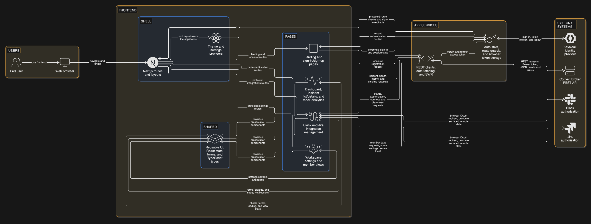

# Context Broker Web 

<p align="center">
  
</p>

[](https://nextjs.org/)
[](https://react.dev/)
[](https://www.typescriptlang.org/)
[](https://tailwindcss.com/)
[](https://www.keycloak.org/)

The official frontend web console for the **Context Broker** platform. It provides operations and engineering teams with real-time incident visibility, enriched contextual triage, integration management, and organizational control.

---

## Overview

Modern microservice architectures generate fragmented alerts across multiple monitoring platforms. Engineers lose critical time cross-referencing logs, tickets, and communication channels.

**Context Broker Web** addresses this problem by serving as the unified command center. It visualizes aggregated incident data, surfaces automated root-cause context, displays chronological event timelines, and synchronizes status directly with collaboration tools like Slack and Jira.

---

## Features

- **Real-Time Incident Dashboard**: High-level triage metrics (active incidents, MTTR, critical triage queue, and severity trends).
- **Incident Intelligence & Timeline**: Detailed incident drill-downs (`/dashboard/incidents/[incidentKey]`) featuring chronological event streams, blast-radius context, and state transitions.
- **Workflow & Assignee Controls**: Modal-driven ticket assignment, status updates, and severity triage.
- **Integration Management**: Centralized hub to connect and configure third-party tools (Slack, Jira, Webhooks) via OAuth or API tokens.
- **Role-Based Access Control (RBAC)**: Fine-grained permission system protecting sensitive operations like audit logs and membership management.
- **Workspace & Organization Settings**: Multi-tenant administration (members, workspace customization, appearance, audit logs).
- **Theme & Accessibility**: System, dark, and light modes with high-contrast accessibility support.

---

## Screenshots

> *Screenshots and workflow previews will be added here.*

---

## Tech Stack

- **Framework**: [Next.js 16](https://nextjs.org/) (App Router, Turbopack)
- **Library**: [React 19](https://react.dev/)
- **Language**: [TypeScript 5](https://www.typescriptlang.org/)
- **Styling**: [Tailwind CSS v4](https://tailwindcss.com/) & Radix UI Primitives
- **Data Fetching & Caching**: [SWR](https://swr.vercel.app/)
- **Authentication**: `keycloak-js` (OIDC / OAuth 2.0 PKCE flow)
- **Icons & Animations**: Lucide React & Framer Motion

---

## Architecture

<p align="center">
  
</p>

The diagram above provides an overview of the frontend architecture. For a clearer view of the components and application flow, [view the full-resolution diagram on Google Drive](https://drive.google.com/file/d/1I6RhgrS_KfTiLinwKYYROVHWx5sXTmxv/view?usp=sharing).

1. **Authentication**: Handled via `keycloak-js`. The client retrieves an OpenID Connect JWT token and automatically handles silent token refreshes with the Keycloak identity provider.
2. **API Communication**: All backend requests are routed through a centralized API client (`src/lib/api/client.ts`) that injects the `Bearer` token and handles HTTP 401 retries with the Spring Boot REST backend.
3. **App Services & SWR**: SWR manages client-side caching, background revalidation, and optimistic state updates across pages and components.
4. **External Integrations**: Facilitates direct OAuth authorization redirects and state reconciliation with external providers like Slack and Jira.

---

## Getting Started

### Prerequisites

- **Node.js**: `v20.x` or later (LTS recommended)
- **Package Manager**: `npm` (v10+), `yarn`, or `pnpm`
- **Backend Services**:
  - Running Spring Boot backend instance (`http://localhost:8081`)
  - Running Keycloak instance (`http://localhost:8080`) with realm configured

### Installation

1. **Clone the repository:**
   ```bash
   git clone https://github.com/05Har-sh/context-broker-web.git
   cd context-broker-web
   ```

2. **Install dependencies:**
   ```bash
   npm install
   ```

3. **Set up environment variables:**
   ```bash
   cp .env.example .env.local
   ```

4. **Start the local development server:**
   ```bash
   npm run dev
   ```

5. Visit [http://localhost:3000](http://localhost:3000) in your browser.

---

## Configuration

The application uses environment variables prefixed with `NEXT_PUBLIC_` for client-side access. Configure them in `.env.local`:

| Variable | Description | Default / Example |
| :--- | :--- | :--- |
| `NEXT_PUBLIC_KEYCLOAK_URL` | Base URL of the Keycloak authentication server | `http://localhost:8080` |
| `NEXT_PUBLIC_KEYCLOAK_REALM` | Target realm name in Keycloak | `context-broker-dev` |
| `NEXT_PUBLIC_KEYCLOAK_CLIENT_ID` | Keycloak client identifier configured with PKCE | `context-broker` |
| `NEXT_PUBLIC_API_BASE_URL` | Base URL of the Spring Boot REST backend | `http://localhost:8081` |

---

## Available Scripts

In the project root, you can execute:

| Command | Description |
| :--- | :--- |
| `npm run dev` | Starts the Next.js development server with Turbopack |
| `npm run build` | Compiles the production build and typechecks the application |
| `npm run start` | Starts the production server using the compiled `.next` output |
| `npm run lint` | Runs ESLint to check for code quality and syntax issues |

---

## Project Structure

```text
context-broker-web/
├── public/                 # Static assets, SVG logos, and SSO callback helpers
├── src/
│   ├── app/                # Next.js App Router (pages, layouts, error & loading states)
│   │   ├── dashboard/      # Incident lists, drilldowns, analytics
│   │   ├── integrations/   # Integration catalog and connections
│   │   ├── settings/       # Organization, appearance, audit, and member settings
│   │   ├── login/          # Authentication entry point
│   │   └── onboarding/     # First-time setup and checklists
│   ├── components/         # Reusable UI widgets, modals, charts, and skeletons
│   │   ├── auth/           # Keycloak AuthProvider and ProtectedRoute
│   │   ├── shared/         # Common badges, filters, headers, toasts
│   │   └── ui/             # Radix & Tailwind design primitives
│   ├── hooks/              # Custom React hooks (e.g., useLoading)
│   ├── lib/                # API clients, Keycloak helper, permissions, utility functions
│   │   └── api/            # Domain-specific API services (incidents, integrations, etc.)
│   └── types/              # TypeScript interfaces and shared data schemas
├── .env.example            # Sample configuration template
├── eslint.config.mjs       # ESLint flat configuration
└── next.config.ts          # Next.js configuration
```

---

## API Integration

### Client & Authentication

The custom HTTP client in `src/lib/api/client.ts` wraps standard `fetch`:
- Attaches the Keycloak Bearer token to each request when `requireAuth: true`.
- Automatically checks token expiration (`MIN_TOKEN_VALIDITY = 15s`) and triggers transparent token renewal.
- On HTTP `401 Unauthorized`, it forces a token refresh cycle and retries the failed request once before prompting re-login.

### Error Handling

API responses with error status codes are mapped to typed exceptions:
- `AuthenticationError` (401)
- `AuthorizationError` (403)
- `NotFoundError` (404)
- `RateLimitError` (429)
- `ApiError` (General fallback)

---

## Deployment

### Production Build

Create an optimized standalone build:
```bash
npm run build
npm run start
```


---

## Contributing

1. **Branch Naming**:
   - `feature/<feature-name>` for new capabilities
   - `fix/<bug-description>` for bug patches
   - `refactor/<scope>` for code cleanup
2. **Commit Convention**: Follow standard Conventional Commits (`feat: ...`, `fix: ...`, `docs: ...`, `refactor: ...`).
3. **Quality Gate**: Run `npm run lint` and `npm run build` locally to ensure there are no build or TypeScript errors before opening a Pull Request.

---

## Backend repository: [Link](https://github.com/05Har-sh/context-broker-api)
